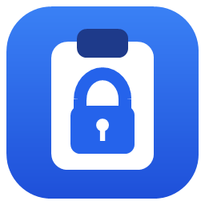
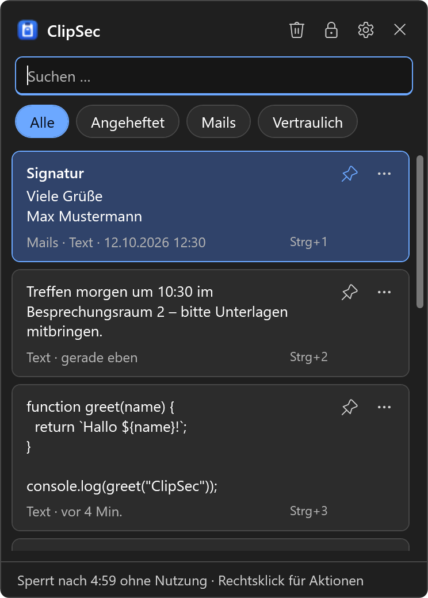
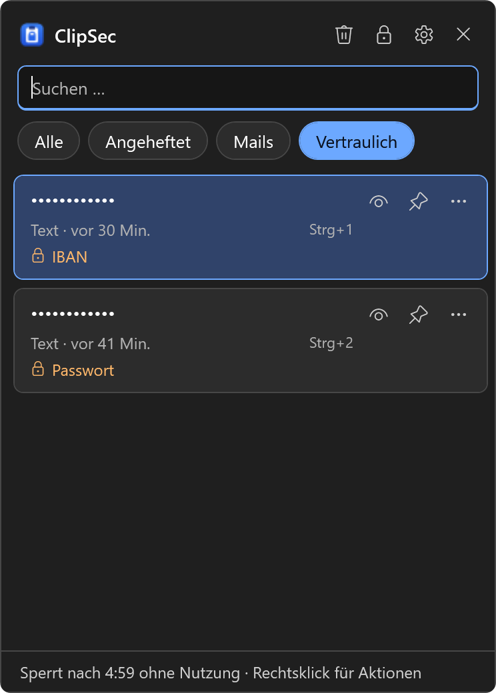

<p align="center">
  
</p>

<h1 align="center">ClipSec</h1>

<p align="center">
  <b>Deine Zwischenablage. Verschlüsselt und gesperrt.</b><br>
  Win+V-Ersatz für Windows 10/11 mit Master-Passwort, Kurz-PIN und Verschlüsselung pro Eintrag.
</p>

<p align="center">
  <a href="https://github.com/LeanoJ/ClipSec/releases/latest"></a>
  <a href="https://github.com/LeanoJ/ClipSec/actions/workflows/ci.yml"></a>
  <a href="LICENSE"></a>
  
</p>

<p align="center">
  
  &nbsp;
  
</p>

Windows merkt sich alles, was du kopierst – und jeder, der kurz an deinem PC sitzt, sieht es mit **Win+V**.
ClipSec ersetzt den eingebauten Verlauf durch einen verschlüsselten Tresor, der erst nach deinem Passwort aufgeht.

**➜ [Download (neueste Version)](https://github.com/LeanoJ/ClipSec/releases/latest)** · Webseite & Container: [`website/`](website/README.md)

## Funktionen

**Sperre**
- **Master-Passwort** ist immer gesetzt und schützt den Verlauf kryptografisch
- **Gleitender Sperr-Timer** (Sofort, 1–60 Min.): Jede Nutzung von ClipSec startet ihn neu; normales Kopieren in anderen Programmen verlängert nichts
- **Kurz-PIN** (optional): nach der ersten Passworteingabe bis Neustart/Abmelden; nach 3/5/10 Fehlversuchen verworfen
- **YubiKey / FIDO2** (optional): *Passwort oder Schlüssel* (Berühren + Schlüssel-PIN genügt) oder *Passwort und Schlüssel* (2-Faktor) – mehrere Schlüssel, jederzeit umschaltbar
- Sperrt bei Win+L, Standby und – optional – wenn der PC X Minuten gar nicht benutzt wurde

**Vertrauliche Inhalte**
- Erkennt Passwörter, IBANs (Prüfsumme), Kreditkarten (Luhn), API-Schlüssel, Tokens, private Schlüssel und Zugangsdaten
- Anzeige als `••••`, Aufdecken per Auge-Symbol; Einträge lassen sich auch von Hand markieren
- Optional: Aufdecken/Einfügen/Bearbeiten verlangt erneut das Master-Passwort (Standard: aus)
- Optional: vertrauliche Einträge nach 5 Min. – 24 Std. automatisch löschen
- **Zwischenablage automatisch leeren**: liegt Vertrauliches in der Zwischenablage, wird sie nach 30 s geleert (einstellbar); optional auch nach jedem Einfügen aus ClipSec. Geleert wird nur, wenn seitdem nichts Neues kopiert wurde.

**Ausschlüsse**
- Programme (z. B. Banking, KeePass), aus denen nie etwas aufgenommen wird
- Inhalte, die Passwortmanager als „nicht in den Verlauf“ markieren, werden ignoriert

**Bedienung**
- Formatierung (HTML/RTF) wird mitgespeichert; **Umschalt+Enter** fügt als reinen Text ein
- **Strg+1 … 9** fügt den n-ten Eintrag direkt ein, **Leertaste** zeigt eine große Vorschau
- **F2** bearbeitet einen Eintrag, **Entf** löscht ihn, **Rechtsklick** zeigt alle Aktionen
- **Textbausteine**: Einträge benennen und in Gruppen sortieren (verschlüsselt); Filter-Chips für Angeheftet/Gruppen/Vertraulich
- Suche, Anheften, Text/Bilder/Dateien, Hell/Dunkel nach Windows-Einstellung

**Aufräumen**
- Nicht angeheftete Einträge optional nach 1–90 Tagen automatisch löschen (funktioniert auch gesperrt)

## Installation

```powershell
.\publish.ps1   # erzeugt dist\ClipSec-Setup.exe (~68 MB, läuft ohne installiertes .NET)
```

`ClipSec-Setup.exe` per Doppelklick starten:
- installiert pro Benutzer nach `%LOCALAPPDATA%\Programs\ClipSec` – **keine Adminrechte**
- Startmenü-Eintrag, optional Desktop-Verknüpfung und Autostart
- Eintrag unter *Einstellungen → Apps* zum Deinstallieren (auch in den ClipSec-Einstellungen unter *Info*)
- erneutes Ausführen aktualisiert eine bestehende Installation (laufende Instanz wird kurz beendet)
- „Ohne Installation starten“ nutzt die EXE portabel

Mit `.\publish.ps1 -FrameworkDependent` wird die EXE ~1 MB groß, braucht dann aber die .NET 8 Desktop Runtime.

**Wichtig:** Schalte unter *Einstellungen → System → Zwischenablage* den **Zwischenablageverlauf** und **Geräteübergreifend synchronisieren** aus. Sonst speichert Windows jede Kopie zusätzlich unverschlüsselt.

Tests (Kryptografie, Speicherformat, Erkennung vertraulicher Inhalte):

```powershell
$env:CLIPSEC_DATA_DIR = "$env:TEMP\clipsec-test"; dotnet run --project ClipSec.Tests
```

## Sicherheitskonzept

| Baustein | Umsetzung |
|---|---|
| Einträge | Pro Eintrag ECDH P-256 (Wegwerf-Schlüssel) + AES-256-GCM, Eintrags-ID als AAD |
| Inhalt | Text, Formatierung, Name und Gruppe eines Textbausteins – alles verschlüsselt |
| Aufnehmen im gesperrten Zustand | Nur mit dem öffentlichen Schlüssel – ClipSec kann gesperrt schreiben, aber nichts lesen |
| Privater Schlüssel | Auf der Platte nur verschlüsselt mit PBKDF2-SHA256 (600 000 Iterationen) aus dem Master-Passwort |
| Kurz-PIN | Schützt **nie** Daten auf der Platte; nur eine Kopie des Schlüssels im Arbeitsspeicher; Prozessende = PIN ungültig |
| Sicherheitsschlüssel | FIDO2 **hmac-secret** über die Windows-WebAuthn-API (Berühren + Schlüssel-PIN). Eigenes Fach je Schlüssel: `HKDF(hmac-secret)`, im 2-Faktor-Modus `HKDF(PBKDF2(Passwort) ‖ hmac-secret)` – dann gibt es kein reines Passwort- oder Schlüssel-Fach |
| Moduswechsel | PBKDF2-Wert und hmac-secrets liegen zusätzlich verschlüsselt *mit dem Tresorschlüssel selbst* vor – nur entsperrt lesbar; erlaubt Umschalten/Passwortwechsel ohne erneutes Berühren |
| Gesperrt | Privater Schlüssel und entschlüsselte Einträge werden aus dem Speicher entfernt |
| Unverschlüsselte Metadaten | Nur Zeitpunkt, angeheftet und „vertraulich“-Flag (für automatisches Löschen im gesperrten Zustand) |
| Brute-Force | Passwort: wachsende Wartezeit ab dem 3. Fehlversuch; PIN: begrenzte Versuche |
| Eigene Einfügungen | Mit `CanIncludeInClipboardHistory=0` / `CanUploadToCloudClipboard=0` markiert |

Daten liegen in `%LOCALAPPDATA%\ClipSec` (`vault.json`, `history.dat`, `settings.json`).

## Grenzen

- Der **aktuelle** Inhalt der Zwischenablage ist per Strg+V einfügbar, bis er (optional) automatisch geleert wird – ClipSec schützt vor allem den **Verlauf**.
- In Fenstern, die **als Administrator** laufen, kann ClipSec Win+V nicht abfangen und nicht automatisch einfügen (Windows-Schutz UIPI).
- Programm-Ausschlüsse richten sich nach dem Programm, das den Inhalt in die Zwischenablage legt. Füllt ein Programm sie ohne eigenes Fenster (z. B. Kommandozeilen-Tools), wird das Programm im Vordergrund angenommen.
- Die Erkennung vertraulicher Inhalte ist heuristisch – Einträge lassen sich jederzeit von Hand markieren oder entmarkieren.
- Gegen Schadsoftware, die unter deinem Benutzerkonto läuft (Keylogger, Speicher auslesen), schützt kein Programm dieser Art.
- Passwort vergessen → *Tray-Menü → Tresor zurücksetzen* löscht den Verlauf. Eine Wiederherstellung gibt es bewusst nicht.
- Im 2-Faktor-Modus gilt dasselbe für verlorene Schlüssel – deshalb einen **Ersatzschlüssel** registrieren.
